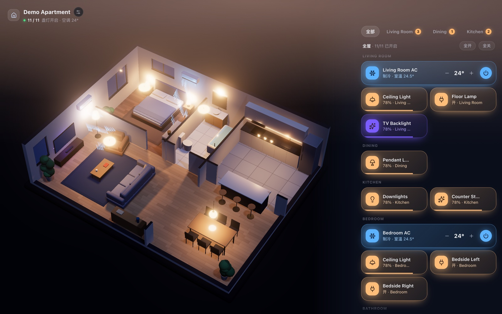
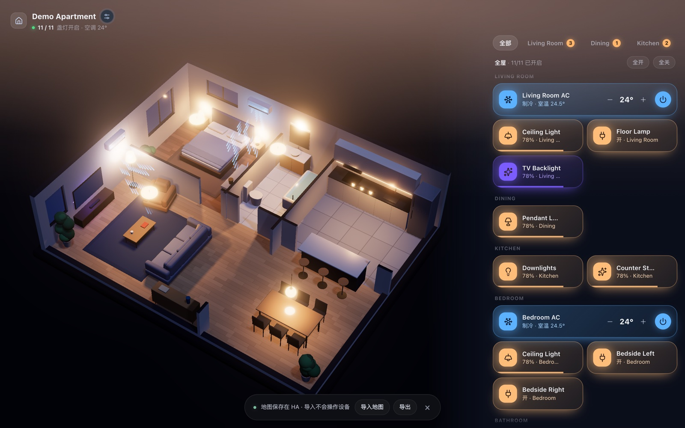
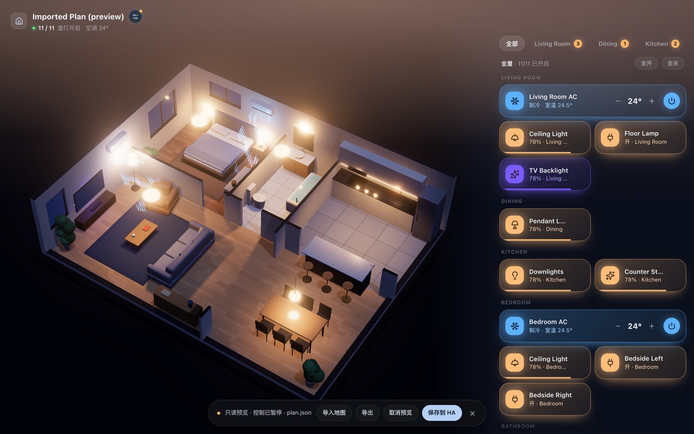
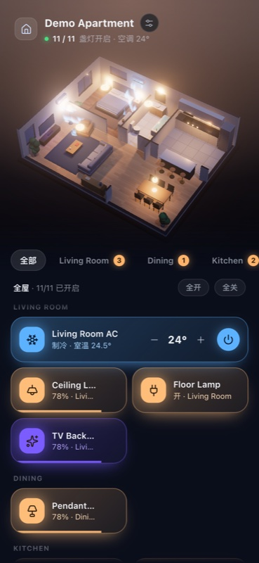

# hass-house-control

Bring **[House Control](https://github.com/0xProbabillity/house-control)**'s live 3D floor plan into Home Assistant as a Lovelace card: your rooms, walls and furniture in 3D, with every lamp and AC in the model wired to a real Home Assistant entity.



> **Credit:** the 3D stage, the `plan.json` format and the Mac App / web editor are all **[House Control](https://github.com/0xProbabillity/house-control)** by **[0xProbability](https://github.com/0xProbabillity)** (MIT, © 2026). This repository only contains the thin Home Assistant card that runs that app inside a Lovelace view. Please star the upstream project — that's where the real work happens.

## Features

- **3D model of your home** as a Lovelace panel view — rooms, walls, doors/windows and furniture.
- **Tap a lamp or AC in the model to control the real entity.** Every fixture in the plan is bound to an entity: toggle it in HA and the model follows; tap the model and `light.turn_on` / `climate.set_temperature` goes out.
- **Device panel grouped by room** with brightness / colour temperature for lights and mode, fan and swing for ACs.
- **Import / export the floor plan** from the card: a read-only preview (device control paused), admin-only save into the current card via `lovelace/config/save`, with an automatic backup download of the previous plan.
- **Three rendering tiers with automatic step-down** — every lamp is a real three.js light, so the card watches frame times and drops quality before it gets janky.



## Install

Two files, no build step:

| File | What it is |
| --- | --- |
| `house-control-card.js` | the custom Lovelace card |
| `embed.html` | the self-contained 3D app (bundle, styles and the HA shim inlined) |

1. Copy both into `<config>/www/house-control/`.
2. **Settings → Dashboards → Resources → Add resource**: `/local/house-control/house-control-card.js`, type **JavaScript module**.
3. Add the card to a **panel view**:

```yaml
type: custom:house-control-card
height: 900
plan: { ... }   # your plan.json contents (see examples/demo-plan.json)
```

> Home Assistant caches `/local` for ~31 days. After updating the files, bump the resource URL to
> `/local/house-control/house-control-card.js?v=2`, otherwise you keep loading the old version.

Want to try it before wiring your own home? Paste [`examples/demo-plan.json`](examples/demo-plan.json) into the `plan:` field — it renders the "Demo Apartment" used in the screenshots, with entities like `light.living_room_ceiling` that you can point at your own lights.

## Card options

```yaml
type: custom:house-control-card
height: 900                # card height in px (ignored in a panel view, which fills the window)
plan: { ... }              # required: the floor plan (House Control's plan.json)
quality: high              # optional: high | medium | low  (omit = pick from the device and auto step-down)
platform: "*"              # optional: require plan entities to come from one integration.
                           # default "xiaomi_home"; set another id, or "*" to accept any integration
ac_rule: true              # optional: only the Away scene may switch ACs off (default true)
away_scene: away           # optional: the id of that "Away" scene (default "away")
app_url: /local/house-control/embed.html   # optional: serve the app from somewhere else
dashboard_path: null       # optional: which dashboard to save an imported plan into
                           # (null = /lovelace; set an url_path for a named storage dashboard)
```

## How it is put together (and why it is safe to embed)

- The card is a **thin shell**. The 3D app runs in an **iframe with `sandbox="allow-scripts"` only** — no `allow-same-origin`, so it gets an opaque origin: no cookies, no `localStorage`, no reach into the Home Assistant frontend.
- The **floor plan travels in the URL fragment** (`#...`), which browsers never send to any server. `embed.html` never leaves your HA instance.
- **Credentials stay outside the sandbox.** The parent card owns `hass`; every device action goes through `hass.callService()` from the parent frame.
- The **plan lives in the card config** (`plan:`), i.e. in your dashboard storage — versioned and backed up with the rest of your configuration.
- Imports are validated before they are applied: JSON shape, size (≤ 1 MB), unique ids, no prototype-polluting keys, entity ids must exist in your registry and must not be disabled.



## Performance

Each lamp becomes a real three.js light that is evaluated per fragment, so cost is driven by pixels shaded, MSAA samples and shadow-casting lamps. The card ships three tiers and drops one step when the median frame time stays slow, never upgrading back so a borderline device settles:

| tier | MSAA | lamp shadows | max pixel ratio |
| --- | --- | --- | --- |
| high | 2 (off on very dense displays) | 3 | 2 |
| medium | 0 | 2 | 1.5 |
| low | 0 | 1 | 1 |

Pin a tier with `quality:` if you prefer a fixed look. Mobile browsers start one step down.



## The floor plan

A plan is one JSON document (`rooms`, `openings`, `furniture`, `lights`, `acs`, `scenes`) — see [`examples/demo-plan.json`](examples/demo-plan.json) for a complete small example. The easiest way to make one is the upstream project: **House Control** has a Mac App and a web studio for drawing the plan, and can even rebuild one from a robot-vacuum map.

A lamp or AC becomes controllable when it carries a Home Assistant binding:

```json
{ "id": "living.main", "name": "Ceiling Light", "room": "living", "type": "ceiling",
  "pos": [2.9, 6.0], "capabilities": ["brightness", "temp"],
  "link": { "service": "homeassistant", "id": "light.living_room_ceiling" } }
```

## Building from source

`src/` holds the card, the iframe shim and the embed stylesheet. `build.sh` bundles the upstream web app into the self-contained `embed.html` and copies the card next to it:

```bash
HC=/path/to/house-control ./build.sh    # expects ../house-control by default
```

It runs `npm run build` inside the upstream `web/` directory, inlines the JS/CSS and the shim into one HTML file, and fails loudly if anything still references `./assets` (the sandbox has an opaque origin, so relative asset fetches would fail there).

## Known limitations

- The in-app UI strings are **Chinese** for now (it grew out of one household); room names, device names and the model itself come from your plan, so they are yours to name. An English locale is very welcome as a PR.
- The guard that checks which integration plan entities come from defaults to `xiaomi_home` (the setup this was built against); set `platform` to match yours.
- The card is tested against Home Assistant's modern storage dashboards; YAML-mode dashboards are untested.

## Credits

- **[House Control](https://github.com/0xProbabillity/house-control)** — by **[0xProbability](https://github.com/0xProbabillity)**, MIT © 2026. The 3D stage, `plan.json`, the editor and the Mac/web apps are theirs.
- [three.js](https://threejs.org/) — the renderer behind the stage.
- Home Assistant frontend / WebSocket API — everything the card talks to.

## License

The card in `src/` is MIT licensed — see [LICENSE](LICENSE). `embed.html` bundles the upstream House Control web app; see [NOTICE](NOTICE.md).
